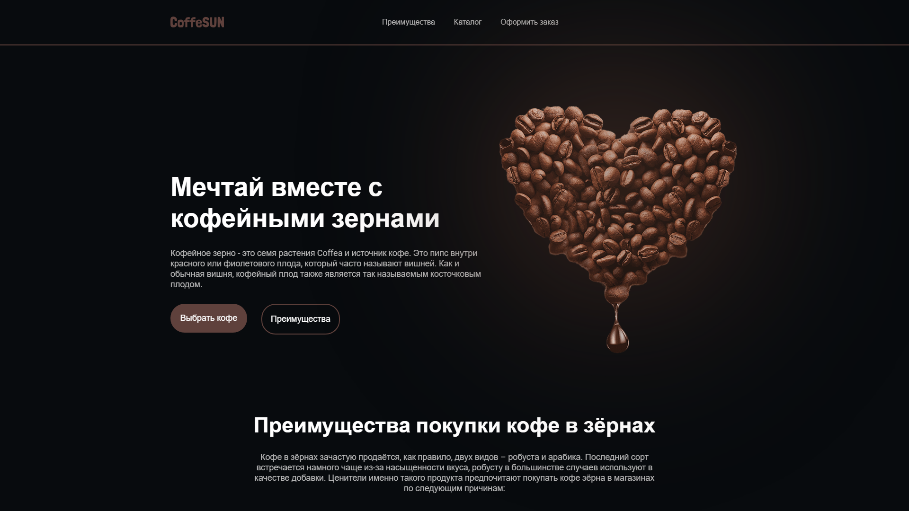
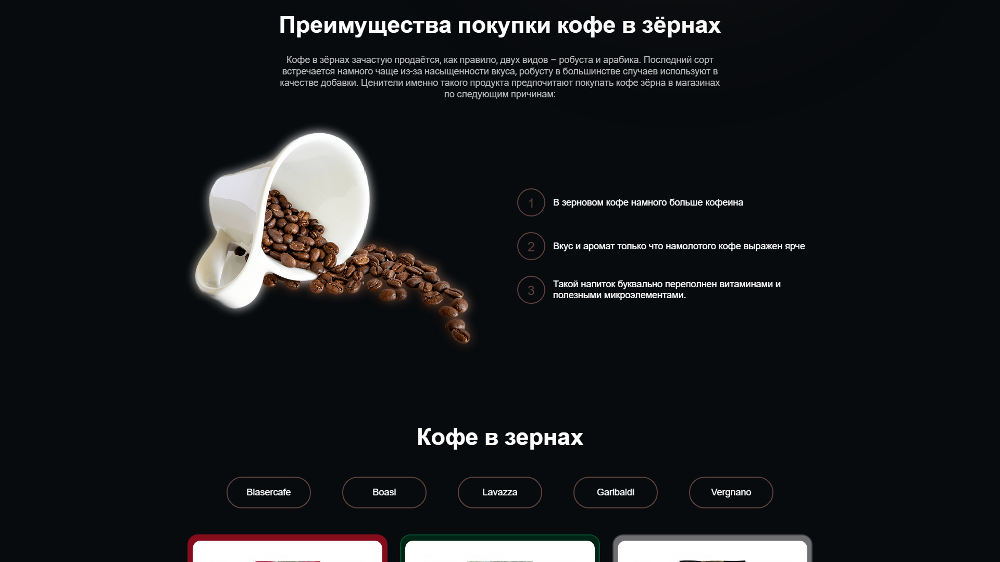
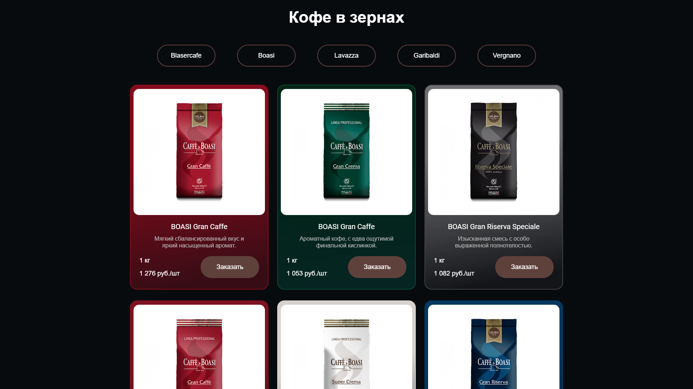
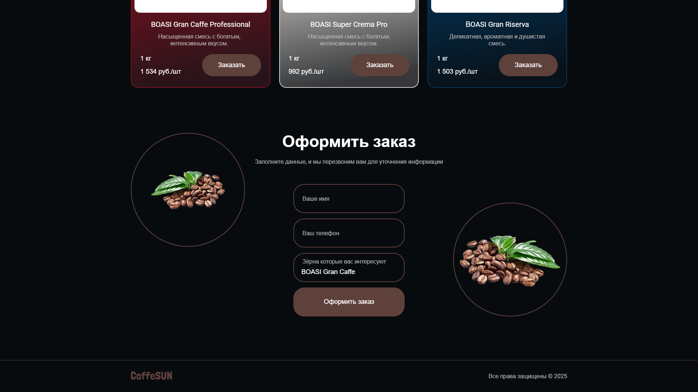

<p align="center">
  
</p>

<p align="center">
  <b>Лендинг кофейни на React: каталог кофе в зёрнах, форма заказа с подстановкой выбранного кофе и анимации.</b>
</p>

<p align="center">
  
  
  
  <a href="https://dekciw.github.io/coffee-code/"></a>
</p>

<p align="center">
  <a href="https://dekciw.github.io/coffee-code/">
    
  </a>
</p>

<br>

<p align="center">
  
</p>

<br>

<table align="center">
  <tr>
    <th>&#8199;&#8199;&#8199;&#8199;&#8199;&#8199;Каталог&#8199;&#8199;&#8199;&#8199;&#8199;&#8199;</th>
    <th>&#8199;&#8199;&#8199;&#8199;&#8199;&#8199;Заказ&#8199;&#8199;&#8199;&#8199;&#8199;&#8199;</th>
    <th>&#8199;&#8199;&#8199;&#8199;&#8199;&#8199;Интерфейс&#8199;&#8199;&#8199;&#8199;&#8199;&#8199;</th>
  </tr>
  <tr>
    <td valign="top">
      - 6 сортов кофе в зёрнах<br>
      - Данные из JSON<br>
      - Вес и цена на карточке<br>
      - Цвет карточки под упаковку<br>
      - Кнопка «Заказать»<br>
      - Блок преимуществ
    </td>
    <td valign="top">
      - Подстановка выбранного кофе<br>
      - Плавная прокрутка к форме<br>
      - Поля имени и телефона<br>
      - Подписи над полями<br>
      - Анимация зёрен по бокам<br>
      - Форма пока без отправки
    </td>
    <td valign="top">
      - Картинка следует за мышью<br>
      - Анимация чашки кофе<br>
      - Меню с якорями<br>
      - Плавная прокрутка<br>
      - Тёмная тема<br>
      - React, Vite и SCSS
    </td>
  </tr>
</table>

<h3 align="center">Как это выглядит</h3>

<table align="center">
  <tr>
    <td width="50%" align="center" valign="top">
      <br>
      <sub>Преимущества кофе в зёрнах</sub>
    </td>
    <td width="50%" align="center" valign="top">
      <br>
      <sub>Каталог</sub>
    </td>
  </tr>
  <tr>
    <td colspan="2" align="center" valign="top">
      <br>
      <sub>Форма заказа после нажатия «Заказать»: кофе подставился сам</sub>
    </td>
  </tr>
</table>

<br>

<details>
<summary><b>Подробнее о проекте: стек, устройство, запуск</b> (нажми, чтобы развернуть)</summary>

<br>

### Стек

<p>
- <b>Интерфейс:</b> React 19<br>
- <b>Сборка:</b> Vite 7<br>
- <b>Стили:</b> SCSS, у каждого компонента свой файл стилей<br>
- <b>Проверка кода:</b> ESLint 9
</p>

### Устройство проекта

```
src/
├── App.jsx                 # шапка, основная часть и подвал
├── components/
│   ├── header/             # логотип и меню с якорями
│   ├── main/
│   │   ├── info/           # первый экран, картинка следует за мышью
│   │   ├── advantages/     # преимущества, кнопки брендов и карточка товара
│   │   ├── products/       # каталог кофе
│   │   └── order/          # форма заказа
│   └── footer/             # подвал
├── data/cardData.json      # сорта кофе: название, описание, вес, цена, цвета
└── index.css               # общие стили и цвета
public/images/              # логотип и фото кофе
```

Кнопка «Заказать» на карточке записывает название кофе в поле формы и плавно прокручивает страницу к блоку заказа.

### Запуск

```bash
npm install
npm run dev        # dev-сервер
npm run build      # сборка в папку dist
npm run lint       # проверка кода
```

</details>
